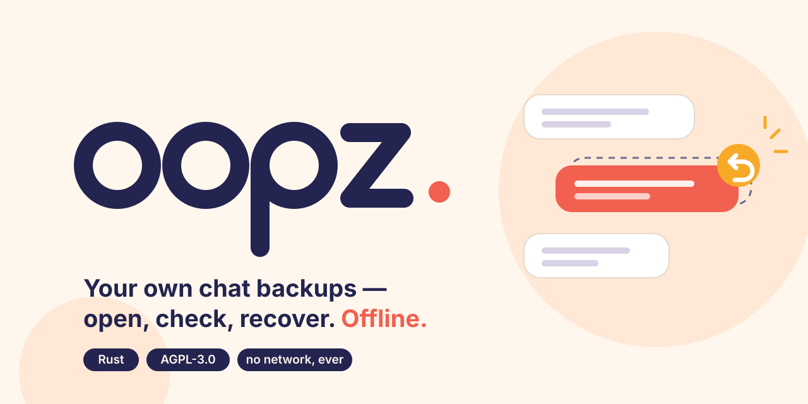

<p align="center">
  <picture>
    <source media="(prefers-color-scheme: dark)" srcset="assets/banner-dark.svg">
    <source media="(prefers-color-scheme: light)" srcset="assets/banner-light.svg">
    
  </picture>
</p>

<p align="center"><b>Open your own WhatsApp backups with your own key, check them, and bring a lost chat back. Offline.</b></p>

<p align="center">
  <a href="https://github.com/sparklitt/oopz/actions/workflows/ci.yml"></a>
  <a href="LICENSE"></a>
  
  
  
</p>

oopz is a small command-line tool for WhatsApp's end-to-end encrypted Android backups (`*.crypt15`). It tells you
whether your backups open and are sound, shows what is inside them (structure and counts, never content), and can
restore a lost one-to-one chat from the other person's backup into a new, checked backup.

## Why

Phones break, chats get deleted by mistake, a restore picks the wrong backup. The messages often still exist: in an
older backup of yours, or on the phone of the person you were talking to. oopz helps you find out what your backups
hold and put a lost chat back, without sending anything anywhere and without touching the originals.

## Features

- 🔍 **Check** every backup in a folder with one key: does it open, is its database sound, how many chats and messages.
- 🗂️ **Inspect** a backup: chats with masked ids, message types per chat, tables and columns. Counts only.
- ↩️ **Restore** a lost one-to-one chat from the other person's backup, mirrored to your side, checked before it is
  written; optionally with the media files it needs.
- 🔒 **Private by design**: offline, keys from a hidden prompt and wiped after use, output is counts and masked ids.

## Demo

<p align="center">
  
</p>

<sub>Replayed from a run on the synthetic test backups (invented people, test keys), never on real data.</sub>

> [!IMPORTANT]
> **Safety first**
>
> - **Your own backups, with your own key, with consent.** oopz opens a backup only with the 64-digit key its owner
>   chose when they turned on end-to-end encrypted backups. It never tries to get around WhatsApp's encryption of
>   anyone's account. To use someone else's backup (for `oopz restore`), they give you their backup and type their
>   own key, knowing what you will do with it.
> - **Originals are never modified.** Backups and `Media/` folders are only read; every result is a new file or
>   folder, and oopz refuses to overwrite an existing one. Work on a copy anyway.
> - **Offline.** oopz makes no network connections. The one exception is the desktop app's update check, off unless
>   you switch it on or click "Check for updates": it asks GitHub whether a newer oopz exists, and sends nothing else.
> - **Counts and masked ids only.** Its output never contains message text, media, phone numbers or keys.
> - **Keys** are read from a hidden prompt (or one line of stdin per key, `oopz … < keyfile`), never from an argument
>   or an environment variable, and wiped from memory after use.

## Install

The desktop app: download the installer for your system from the
[latest release](https://github.com/Sparklitt/oopz/releases/latest).

- **Windows**: `oopz_<version>_x64-setup.exe` (or the `.msi`). It isn't signed yet, so SmartScreen says "Windows
  protected your PC": choose **More info › Run anyway**.
- **macOS** (Apple silicon and Intel): `oopz_<version>_universal.dmg`. It isn't signed or notarized yet: drag oopz to
  Applications and open it once; when macOS says it can't check it, go to **System Settings › Privacy & Security** and
  choose **Open Anyway**.
- **Linux**: `.deb` (Debian, Ubuntu), `.rpm` (Fedora, openSUSE) or `.AppImage` (any; make it executable).

To check a download is the one built here from this source, compare its hash with the release's `SHA256SUMS.txt`
(`sha256sum <file>`, or `Get-FileHash <file>` in PowerShell) and verify its provenance with the GitHub CLI:
`gh attestation verify <file> --repo Sparklitt/oopz`.

## Quick start (command line)

You need Rust 1.89 or newer ([rustup.rs](https://rustup.rs)) and a C compiler (SQLite is built from source).

```sh
git clone https://github.com/sparklitt/oopz && cd oopz
cargo install --locked --path crates/oopz-cli   # installs the `oopz` binary
# or build without installing:
cargo build --release                           # target/release/oopz
```

Copy your backup off the phone first (WhatsApp keeps it in `Android/media/com.whatsapp/WhatsApp/Databases/`) and work
on the copy:

```sh
oopz backups --dir Databases/                          # do they all open, and are they sound?
oopz chats --backup Databases/msgstore.db.crypt15      # which chats, how many messages
```

Every command that opens a backup asks for its 64-digit key.

## Usage

| Command | What it does |
|---|---|
| `oopz backups --dir <folder>` | Checks every `*.crypt15` in a folder with one key: does it open, is its database sound, how many chats and messages, the newest message's date. Fails if any backup doesn't pass (another key, damaged, cut off). |
| `oopz chats --backup <file>` | Lists the chats in a backup: number, masked id, messages, last message's date. |
| `oopz types --backup <file> --chat N` | For each WhatsApp message type in chat N: counts and which tables its rows link to. No content. |
| `oopz tables --backup <file>` | Every table with its columns and row count. Structure only, no values. |
| `oopz chat-facts --backup <file> --chat N` | How WhatsApp keeps one chat: ordering ids, senders, statuses, pointers. Counts and ranges only; useful to compare two phones. |
| `oopz restore --source <file> --source-chat N --target <file> --target-chat M --out <new file> [--media <folder> --media-out <new folder>]` | Restores a lost one-to-one chat (see below). |

`oopz --help` and `oopz <command> --help` describe every flag.

### Restoring a lost chat

Two people share a one-to-one chat; one of them lost it (or part of it), the other still has it. `oopz restore` adds
the messages of the chat in the **source** backup (the one that has them) that the same chat in the **target** backup
(the person who lost it) lacks, mirrored to the target owner's side, and writes a new, checked backup for the target's
owner. It asks for the source's key, then the target's.

- Nothing the target has is changed or lost; added messages are placed before the target's own, in order.
- Before writing, the result is decrypted again and checked (database integrity, counts, ordering, references, every
  other chat identical). If any check fails, nothing is written.
- With `--media` (a copy of the source phone's `Media/` folder) and `--media-out`, the files the result needs that the
  target lacks are copied out, laid out like the target's `Media/` folder.
- Afterwards, run `oopz chat-facts` on the result.

> [!WARNING]
> **Read before restoring on a phone.** This changes a WhatsApp backup, which WhatsApp's terms may not allow; the
> account owner accepts that risk. It has been used for real restores only a few times, on a few phones and WhatsApp
> versions. Keep the original backup and move the phone's `WhatsApp/` folder aside before clearing WhatsApp's data, so
> you can always go back. The design and its checks are in
> [docs/decisions/0006](docs/decisions/0006-merge-a-chat-back-into-whatsapp.md).

## Built with

- [Rust](https://www.rust-lang.org) (edition 2024, `unsafe` forbidden) and [clap](https://crates.io/crates/clap) for
  the command line.
- [rusqlite](https://crates.io/crates/rusqlite), with SQLite built from source, to read and check the backup's
  database.
- Vetted [RustCrypto](https://github.com/RustCrypto) crates for the backup's encryption:
  [aes-gcm](https://crates.io/crates/aes-gcm), [hkdf](https://crates.io/crates/hkdf) and
  [sha2](https://crates.io/crates/sha2); [md-5](https://crates.io/crates/md-5) only for the backup's footer (not for
  security). No home-made cryptography; the choice is recorded in
  [docs/decisions/0004](docs/decisions/0004-whatsapp-backup-decryption.md).
- [prost](https://crates.io/crates/prost) for the backup's header, [flate2](https://crates.io/crates/flate2) for its
  compressed database, [zeroize](https://crates.io/crates/zeroize) and [rpassword](https://crates.io/crates/rpassword)
  for keys, [jiff](https://crates.io/crates/jiff) for dates.

## FAQ

<details>
<summary><b>Is this legal?</b></summary>

oopz opens only backups whose owner gives you their key; it never breaks or bypasses anyone's encryption. Reading
your own data is yours to do. `oopz restore` writes a changed backup, which WhatsApp's terms may not allow: the
account owner decides and accepts that risk. This is not legal advice.
</details>

<details>
<summary><b>Does it upload anything?</b></summary>

No. oopz has no telemetry and never uploads backups, keys or results. The command line makes no network connections
at all. The desktop app goes online only to check for updates, and only if you switch that on or click "Check for
updates" ([decision 0011](docs/decisions/0011-an-opt-in-update-check.md)).
</details>

<details>
<summary><b>Which backups does it support?</b></summary>

WhatsApp's end-to-end encrypted Android backups, `msgstore.db.crypt15`, opened with the 64-digit key. Older formats
(`crypt12`, `crypt14`) and iPhone backups are not supported. WhatsApp's database changes between versions; oopz reads
what it finds and checks its results, and `oopz tables` helps when something looks different.
</details>

<details>
<summary><b>I lost my key. Can oopz help?</b></summary>

No. Without its key a crypt15 backup cannot be opened, and oopz will never try.
</details>

## Roadmap

- [x] `backups`, `chats`, `types`, `tables`, `chat-facts`: check and inspect.
- [x] `restore`: a lost one-to-one chat, checked before it is written.
- [ ] **`view`**: an offline HTML viewer of your own backup, with stats (coming).
- [ ] **`check`**: a backup health report you can keep (coming).
- [ ] **Desktop app** (Tauri 2, English and Spanish): step by step from the phone to a merged backup, with stats
  and fast search; a first version is in [`apps/desktop`](apps/desktop) ([plan](docs/desktop-plan.md)).
- [ ] Release binaries for Linux, macOS and Windows.

## Contributing

Issues and pull requests are welcome. Please read [CONTRIBUTING.md](CONTRIBUTING.md) first: **never attach a real
backup, key, media or phone number**; tests use the synthetic backups of the `fixtures` feature. Design records are
in [docs/decisions](docs/decisions/README.md), vulnerabilities go through [SECURITY.md](SECURITY.md), and everyone
follows the [Code of Conduct](CODE_OF_CONDUCT.md).

```sh
cargo fmt --check
cargo clippy --all-targets -- -D warnings
cargo test
```

## Licence

[GNU Affero General Public License v3.0 or later](LICENSE) (`AGPL-3.0-or-later`).

---

<sub>oopz is not affiliated with, endorsed by or sponsored by WhatsApp or Meta. WhatsApp is a trademark of its
owner.</sub>
